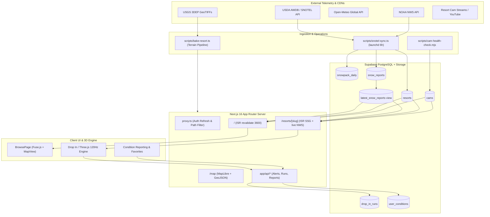
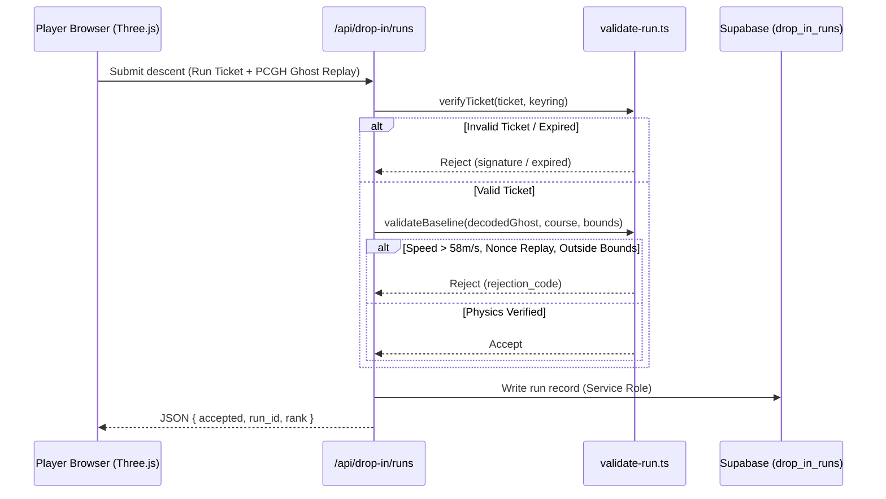

# PeakCam — Comprehensive Codebase Review

An in-depth architectural, code-quality, performance, and security evaluation of **PeakCam** (Next.js 16, React 19, Supabase, Tailwind CSS 4, Three.js).

---

## 1. Executive Summary & Verification Metrics

PeakCam is an exceptionally well-architected, production-grade application combining:
1. A **live webcam and snow-conditions aggregator** for 150+ North and South American ski resorts.
2. A **deterministic, physics-driven 3D downhill ski simulation** ("Drop In" / "Descent") complete with server-validated anti-cheat, gate-timing, terrain baking from USGS GeoTIFFs, and ghost replays.
3. An **automated data ingestion pipeline** combining USDA SNOTEL/AWDB telemetry, NOAA NWS forecasts, Open-Meteo, crowd reports, and cam health monitors.

### Verification Health Check

| Check | Result | Details |
|---|---|---|
| **TypeScript (`tsc --noEmit`)** | **PASSED (0 errors)** | Full strict typing across all web app, 3D engine, and server route modules. |
| **ESLint (`npm run lint`)** | **PASSED (0 errors, 53 warnings)** | Clean; warnings are confined to unused variable markers (`_var`) and prototype scripts. |
| **Core App Unit Tests (`lib/*.test.ts`)** | **PASSED (155/155 passed)** | Completed in **850ms** (`conditions-engine`, `supabase`, `weather`, `open-meteo`, `posthog-sanitize`, etc.). |
| **Descent 3D Engine Tests (`lib/descent/`)** | **PASSED (39/39 passed)** | Audio graph, input ramps, rider posing, course navigation, tree spatial hashes all passing. |
| **Parity Tests (`tests/`)** | **PASSED (3/3 passed)** | Bit-for-bit golden trajectory match against historical v1 fixtures. |
| **Full Suite (`npm test`)** | **ATTENTION NEEDED** | Fails on [scripts/bake-resort.test.ts](file:///Users/jaredschueler07/peakcam/scripts/bake-resort.test.ts#L35) due to missing local `gdal_translate` binary. Also, running all ~1,500 tests concurrently causes thread starvation in [AdaptiveTerrainMesh.test.ts](file:///Users/jaredschueler07/peakcam/lib/game/rendering/AdaptiveTerrainMesh.test.ts#L48) (which passes in <1s when run independently). |

---

## 2. Architecture & Data Flow

### The Three Supabase Clients
The codebase enforces clear separation of database clients:
1. [lib/supabase.ts](file:///Users/jaredschueler07/peakcam/lib/supabase.ts#L36): Module-level anon-key client used exclusively for public reads. Wrapped with [`withFetchTimeout`](file:///Users/jaredschueler07/peakcam/lib/supabase.ts#L31) (8s timeout) to prevent transient network hangs from breaking ISR page revalidations.
2. [lib/supabase-browser.ts](file:///Users/jaredschueler07/peakcam/lib/supabase-browser.ts#L6): `@supabase/ssr` browser client for client components needing interactive session access (favorites, dashboard customization, auth modals).
3. [lib/supabase-server.ts](file:///Users/jaredschueler07/peakcam/lib/supabase-server.ts#L9): Cookie-bound server client reading the user session in Server Components and Route Handlers with RLS enforcement.

> [!NOTE]
> [proxy.ts](file:///Users/jaredschueler07/peakcam/proxy.ts#L10) (Next 16 middleware) calls `supabase.auth.getUser()` on incoming requests to refresh tokens. It excludes `/drop-in/`, `favicon.ico`, and static assets to eliminate needless database roundtrips.

---

## 3. Data Ingestion & Conditions Engine

### Active Feed vs. Dormant Pipeline
The repository contains two parallel data ingestion pipelines:

1. **Active Feed ([scripts/snotel-sync.ts](file:///Users/jaredschueler07/peakcam/scripts/snotel-sync.ts#L1)):**
   - Scheduled via Mac Mini launchd job (`com.peakcam.snotel-sync`, runs every 6 hours).
   - Fetches AWDB SNOTEL telemetry.
   - Runs QC checks via [lib/snow-quality.ts](file:///Users/jaredschueler07/peakcam/lib/snow-quality.ts#L71) (flagging suspect spikes, missing values, physical limits).
   - Stores time series in `snowpack_daily`.
   - Computes condition ratings, 7-day SWE trends, and 48-hour outlooks via [lib/conditions-engine.ts](file:///Users/jaredschueler07/peakcam/lib/conditions-engine.ts#L86).
   - Appends rows to `snow_reports` (`source='snotel'`) and updates `resorts.cond_rating`.

2. **Dormant Pipeline ([lib/pipeline/](file:///Users/jaredschueler07/peakcam/lib/pipeline/)):**
   - Designed as a multi-source blender (SNOTEL + NWS + Liftie + SNODAS + Weather Unlocked + crowd reports).
   - While code-complete, [docs/data-pipeline-status.md](file:///Users/jaredschueler07/peakcam/docs/data-pipeline-status.md) notes that it is not actively feeding production.
   - **Risk:** Both `snotel-sync.ts` and `pipeline-sync.ts` write to `snow_reports` and overwrite `resorts.cond_rating` (last writer wins).
   - **Stale Scripts:** `package.json` contains `"liftie-sync": "tsx scripts/liftie-sync.ts"` and `"snodas-sync": "tsx scripts/snodas-sync.ts"`, but neither script file exists on disk.

### Conditions Engine Logic
[lib/conditions-engine.ts](file:///Users/jaredschueler07/peakcam/lib/conditions-engine.ts) is implemented as pure, side-effect-free functions:
- **Rating Thresholds:** Great (≥6" 24h or ≥12" 48h), Good (≥2" 24h + 100% normal + 24" base), Fair (70% normal + 20" base), Poor.
- **Trend Detection:** Evaluates 7-day SWE history against a 0.5" change threshold.
- **Crowd Report Blending:** If ≥2 unflagged crowd reports are submitted in the last 24 hours, ratings blend 70% automated / 30% crowd consensus, clamped to ±1 tier.

---

## 4. Drop In & Descent 3D Simulation Engine

PeakCam contains an arcade descent ski game with an architecture rarely seen in web applications:

### Engine Highlights:
- **Deterministic 120Hz Timebase:** Physics clock runs at fixed 120Hz ([lib/game/core/clock.ts](file:///Users/jaredschueler07/peakcam/lib/game/core/clock.ts)), decoupled from variable display refresh rates.
- **Server-Side Anti-Cheat:** [lib/game/server/validate-run.ts](file:///Users/jaredschueler07/peakcam/lib/game/server/validate-run.ts#L1) verifies HMAC run tickets, checks nonces to block replay attacks, enforces speed ceilings (58 m/s), validates gate passage sequences, and decompresses binary PCGH ghost formats.
- **Terrain Pipeline:** [scripts/bake-resort.ts](file:///Users/jaredschueler07/peakcam/scripts/bake-resort.ts) samples USGS 3DEP GeoTIFF elevation data, projects to UTM coordinates, resolves nodata holes, and encodes heights into precompressed Brotli UInt16 heightfields (`*.height.u16.br`).
- **Sandboxing:** The game iframe ([components/drop-in/DropInFrame.tsx](file:///Users/jaredschueler07/peakcam/components/drop-in/DropInFrame.tsx)) runs in a sandbox *without* `allow-same-origin`, preventing client game code from accessing app cookies or storage.

---

## 5. Security & Privacy Posture

### Strengths

1. **Capability Token Protection & PostHog Redaction:**
   In [lib/posthog-sanitize.ts](file:///Users/jaredschueler07/peakcam/lib/posthog-sanitize.ts#L13), a `before_send` hook sanitizes every string property in outbound analytics events. It strips bearer capability tokens (`manage_token`, `token_hash`, `access_token`, `code`) from URLs and query fragments.

2. **Fail-Closed API Authentication:**
   - [app/api/alerts/trigger/route.ts](file:///Users/jaredschueler07/peakcam/app/api/alerts/trigger/route.ts#L213): If `CRON_SECRET` is unset, the handler returns 500 rather than falling open. If the bearer token does not match, it returns 401.
   - [app/api/admin/bug-reports/route.ts](file:///Users/jaredschueler07/peakcam/app/api/admin/bug-reports/route.ts#L6): Enforces strict reviewer authorization via [lib/bug-reports/review-server.ts](file:///Users/jaredschueler07/peakcam/lib/bug-reports/review-server.ts#L6), verifying active user sessions against `bug_report_reviewers` using a service-role client.

3. **Injection & SSRF Defense:**
   - [app/api/alerts/subscribe/route.ts](file:///Users/jaredschueler07/peakcam/app/api/alerts/subscribe/route.ts#L52) explicitly strips quote characters and percent-encodes user inputs before embedding them in PostgREST queries.
   - [lib/cam-status/brownrice.ts](file:///Users/jaredschueler07/peakcam/lib/cam-status/brownrice.ts) enforces host allowlists, rejects private IP ranges (`127.0.0.1`, `localhost`), and validates URL schemes to prevent SSRF during camera health probing.

4. **Abuse Mitigation on Crowd Reports:**
   - [app/api/user-conditions/submit/route.ts](file:///Users/jaredschueler07/peakcam/app/api/user-conditions/submit/route.ts#L71) checks rate limits using the service-role client. Because RLS hides `is_flagged=true` rows from end users, an RLS query would allow a spammer to submit repeatedly; using the service-role ensures flagged submissions still count toward rate limits.
   - [app/api/cam-reports/submit/route.ts](file:///Users/jaredschueler07/peakcam/app/api/cam-reports/submit/route.ts#L25) hashes client IPs with a daily rotating salt before storing.

### Vulnerabilities & Operational Risks

> [!CAUTION]
> **Ops Dashboard ([dashboard/server.js](file:///Users/jaredschueler07/peakcam/dashboard/server.js#L1)):**
> The Express ops server on port 3333 is **completely unauthenticated** and can spawn shell processes via `child_process.spawn`. It must **never** be exposed outside `localhost`/`127.0.0.1`.

> [!WARNING]
> **CSP In Report-Only Mode ([next.config.ts](file:///Users/jaredschueler07/peakcam/next.config.ts#L74)):**
> `Content-Security-Policy-Report-Only` is configured instead of enforcing `Content-Security-Policy`. Because webcam operators embed diverse third-party frames, this was chosen deliberately to prevent broken cam tiles; however, it means browser-side policy enforcement is currently passive.

---

## 6. Database Schema & Migration Health

The database contains 18 migrations (`001_initial.sql` through `017_drop_in_morning_conditions.sql` + recent bug report migrations).

### Key Observations & Drift:
- **`latest_snow_reports` View:** Created in `001` as `SELECT DISTINCT ON (resort_id) *`. When columns were added to `snow_reports` in `005` and `007`, the view did not automatically expose them. Migration [013_recreate_latest_snow_reports_view.sql](file:///Users/jaredschueler07/peakcam/supabase/migrations/013_recreate_latest_snow_reports_view.sql#L19) resolved this, but future migrations adding columns must explicitly recreate this view.
- **Cam Duplication Risk:** The `cams` table does not have a unique constraint on `(resort_id, embed_url)` or `(resort_id, name)`. Running [scripts/import-resorts-standalone.mjs](file:///Users/jaredschueler07/peakcam/scripts/import-resorts-standalone.mjs) with `resolution=ignore-duplicates` will duplicate cam records if they exist.
- **Manual Migration Application:** Migrations are applied manually via SQL Editor or MCP tools rather than through a declarative CLI or CI migration runner.

---

## 7. Design System & Frontend

### Retro Ski-Poster Theme
PeakCam has transitioned to a retro ski-poster design system:
- **Palette:** Cream paper (`--pc-cream-50: #faf4e6`, `--pc-cream: #f1e7cf`), ink typography (`--pc-ink: #2a1f14`), forest green (`--pc-forest: #3c5a3a`), alpenglow orange (`--pc-alpen: #d9552f`), mustard gold (`--pc-mustard: #e2a740`).
- **Typography:** Fraunces (display headings), DM Sans (body UI), JetBrains Mono (data readouts).
- **Hard Stamp Shadows:** Crisp offset shadows (`box-shadow: 3px 3px 0 var(--pc-ink)`).

### Legacy Token Alias Layer
[tailwind.config.ts](file:///Users/jaredschueler07/peakcam/tailwind.config.ts#L87) maintains a legacy alias layer mapping old dark-theme names (`bg`, `surface`, `surface2`, `cyan`) to paper-theme equivalents. 

> [!NOTE]
> Components such as [ResortDetailPage.tsx](file:///Users/jaredschueler07/peakcam/components/resort/ResortDetailPage.tsx), [SnowReportPage.tsx](file:///Users/jaredschueler07/peakcam/components/snow-report/SnowReportPage.tsx), and [FavoritesPage.tsx](file:///Users/jaredschueler07/peakcam/components/browse/FavoritesPage.tsx) still reference legacy token names. New features should strictly use `pc-*` tokens.

---

## 8. Prioritized Recommendations & Action Items

### Priority 1: Immediate Bug Fixes & Test Suite Polish
1. **Mock GDAL in Tests:**
   Update [scripts/bake-resort.test.ts](file:///Users/jaredschueler07/peakcam/scripts/bake-resort.test.ts#L35) to check whether `gdal_translate` exists in PATH, and skip or mock the GeoTIFF translation when running in standard environments without GDAL installed.
2. **Clean Up Broken `package.json` Scripts:**
   Remove or fix `"liftie-sync"` and `"snodas-sync"` in [package.json](file:///Users/jaredschueler07/peakcam/package.json#L22) as those files do not exist in `scripts/`.
3. **Resolve Test Suite Parallelism Contention:**
   Tune the `npm test` script (e.g. `--test-concurrency` or partitioning test suites) so heavy 3D simulation tests in `lib/game/` do not starve adjacent test processes.

### Priority 2: Ingestion & Pipeline Consolidation
1. **Decide on Multi-Source Pipeline vs. SNOTEL Sync:**
   Currently, `snotel-sync.ts` is the sole production feed, while `lib/pipeline/` is dormant. Either formally deprecate `lib/pipeline/` or complete its activation to eliminate dual-writer risks.
2. **Add Unique Constraint on `cams`:**
   Add a unique constraint (e.g., `UNIQUE(resort_id, embed_url)`) in a migration so re-running import scripts is idempotent.

### Priority 3: Component Token Migration
1. **Migrate Remaining Legacy Components:**
   Convert legacy Tailwind utility classes in `ResortDetailPage`, `SnowReportPage`, and `FavoritesPage` to the new `pc-*` tokens, allowing the legacy alias layer in `tailwind.config.ts` to eventually be retired.
